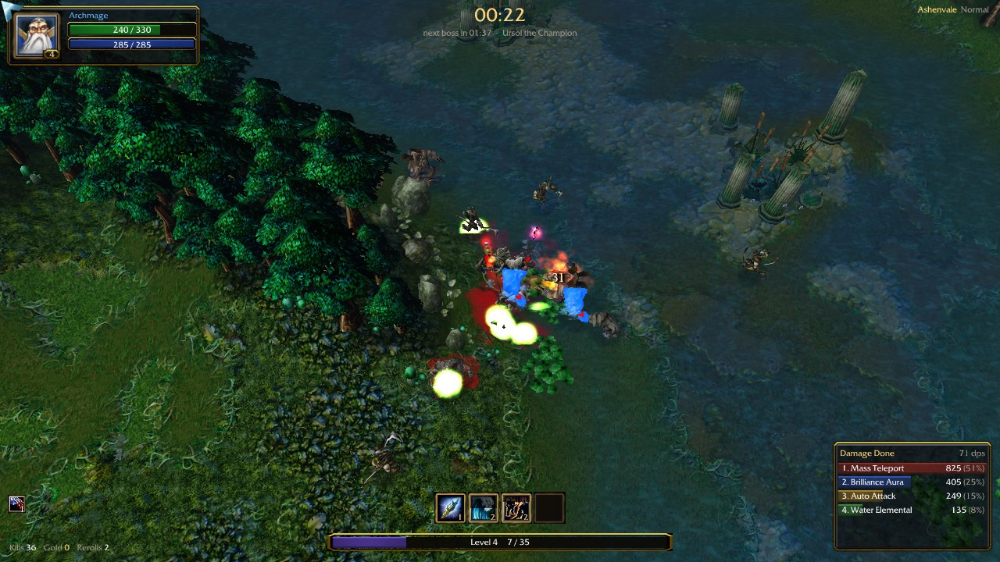
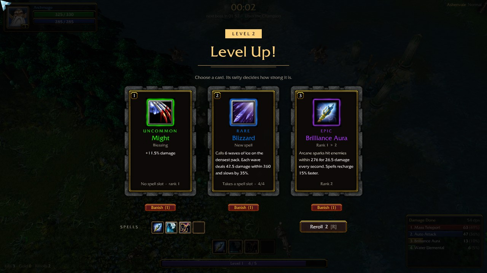
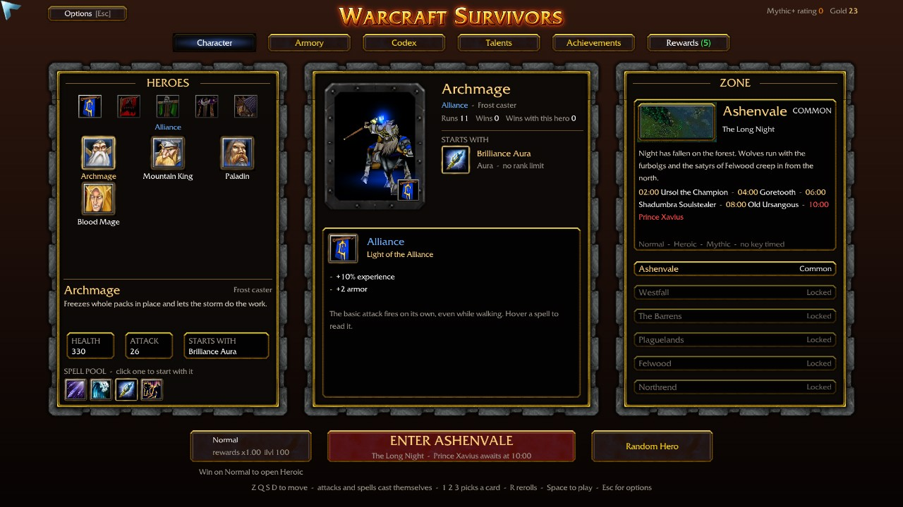
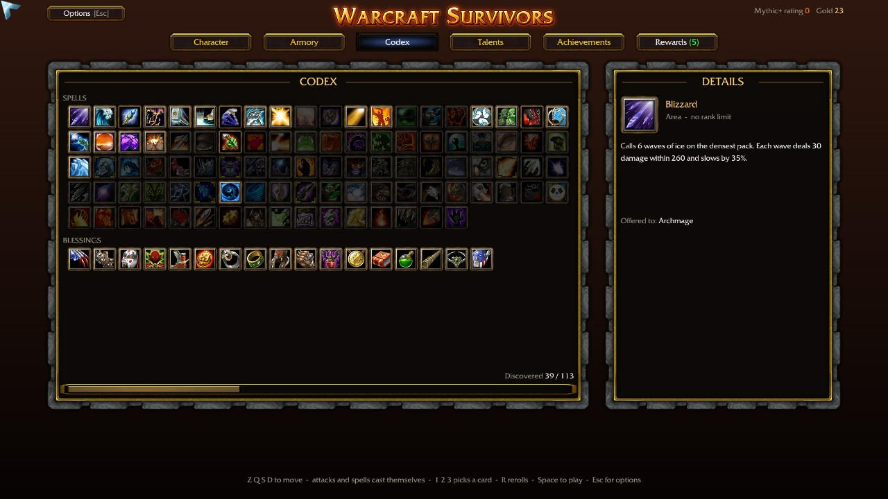
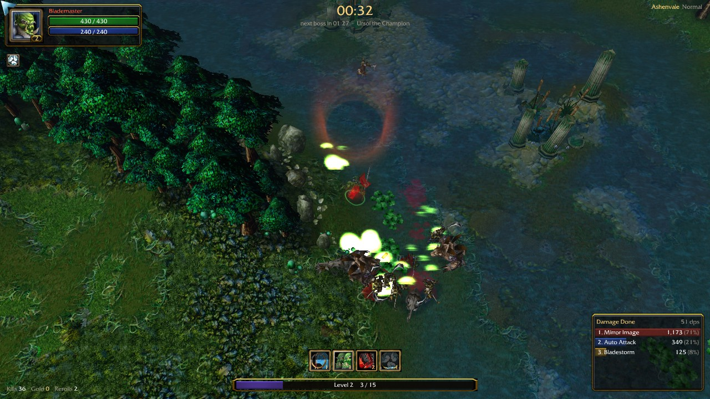

# Warcraft Survivors

A free, fan-made survivors game built from Warcraft III. Pick one of 25 heroes, walk into one of
12 zones and survive ten minutes of ever-growing hordes. Your spells cast themselves; you move,
dodge, collect experience and choose a level-up card each level. Every two minutes a boss
arrives, and at 10:00 the zone's final boss. Beat it and you can keep going in Endless mode.

It runs on [OpenRealm](https://github.com/corepunch/open-realm), an open-source C
reimplementation of the Warcraft III engine, with the art, models, sounds and music of your
own Warcraft III install. The same script also runs as a custom map in Warcraft III Reforged.

### [▶ Play in your browser](https://warcraftsurvivor.para-bellum.eu)

Any recent Chromium browser on a computer (Chrome, Edge, Opera, Brave...). The first visit
downloads about 200 mb of game data, once.



## Features

### Heroes and spells

- **25 heroes** from the five factions of The Frozen Throne: Alliance, Horde, Undead, Night Elf
  and the Tavern (the Tavern includes Medivh, the Last Guardian). Each hero has its own
  Warcraft III abilities, reworked for a survivors game (Blizzard, Bladestorm, Feral Spirit,
  Starfall, Inferno, Storm Earth and Fire...), a pool of spells you draw from, and a starting spell
  you choose in the lobby. Each faction adds its own trait.
- **Over 100 spells** in about a dozen behaviours: bolts, novas, zones, chains, lines, orbits,
  auras, summons, heals, buffs and passives. Storm, Earth and Fire is a real split: the hero
  becomes three spirits for a while, and the enemies attack them.
- **Summons that pile up**: water elementals, spirit wolves, skeletons, treants, infernals and
  more each last one cooldown; raise your spell duration and the waves overlap into an army.
- **Ranged and melee attacks** use the Warcraft III weapon of each hero, with its real projectile
  and impact sounds.

### Level-up cards and rarity

- **Cards in World of Warcraft rarities**, from Common to Legendary. Rarity adds power to the
  card when you pick it. A card can be a new spell, a higher rank for one you have, or a
  **blessing**: a stat card any hero can draw, which takes no spell slot.
- **Nothing has a rank limit.** Four spell slots, as many ranks as you can afford.
- **Reroll and banish** the cards you do not want. Perks in the lobby add more rerolls, banishes,
  and skips.
- **Blessings:** Might, Vitality, Swiftness, Haste, Wisdom, Greed, Magnetism, Precision,
  Regeneration, Armor, Siphon Life (lifesteal), Keen Eye, Lucky, Wide, Second Wind, and more.

### Zones, bosses and difficulty

- **12 zones**: Ashenvale, Westfall, Tirisfal Glades, The Barrens, Stranglethorn Vale,
  Plaguelands, Alterac Valley, Felwood, Dalaran, Hellfire Peninsula, The Black Temple and
  Northrend. Each zone is its own official melee map, with its own horde of creeps and faction
  units, four bosses and a final boss. Win a zone to open the next.
- **Difficulties**: Normal, Heroic, Mythic and Mythic+. Each one opens by winning the one before
  in that zone. Mythic+ has no level cap.
- **Endless mode**: after the final boss, the zone keeps going. Enemies gain health and damage
  every minute, a boss returns every 90 seconds, and your longest endless time is kept per zone.

### Between runs

- **Armory**: gear dropped by bosses, nine slots, each one stat. Upgrade your gear with gold.
- **Talents**: bought with the gold you earn in runs, and they apply to every hero.
- **Achievements and Rewards**: 28 achievements, whose points buy perks such as the **Wisp
  Companion** (a wisp that fetches gems and gold for you, with three ranks).
- **Codex**: every spell and blessing, with its description.

### In the run

- **World objects** appear across the arena: mine carts, barrels, chests, piles of treasure,
  standards of wealth, and shrines of chance or protection. Walk into one to use it.
- **Inventory and stats panels**: the inventory sits top right, and the stats panel under the
  hero frame shows each stat with the blessing that raises it (hide it with C).
- **Boss telegraphs**: the boss's big attacks show on the ground first, as a warning circle, cone,
  line or ring, so you can step out of the way.
- **Enemies block your path**: you cannot walk through a crowd, but Raven Form and Wind Walk pass
  through.
- Damage meter, floating damage numbers, rebindable keys, mouse or keyboard movement, and
  separate volume for master, music, spells, units and ambience.



| Lobby | Codex |
| --- | --- |
|  |  |



## Controls

| Input | Action |
| --- | --- |
| Left or right click on the ground | Walk there |
| Hold the click | The hero follows the cursor |
| W A S D | Walk, when keyboard movement is on (Options > Keybinds) |
| 1 2 3 4 | Pick a level-up card |
| R | Reroll the cards |
| C | Show or hide the stats panel |
| Space | Enter the zone (lobby) |
| Esc | Game menu: options, audio, keybinds, interface |

Every key can be rebound in the game menu. Binding a key that is already used swaps the two.
Movement is either the mouse or the keyboard, never both at once.

**Touch** (browser, phones and tablets): one finger on the world walks, and the HUD has a Menu
button in place of the Escape key.

## Playing

### In your browser

Open **[warcraftsurvivor.para-bellum.eu](https://warcraftsurvivor.para-bellum.eu)** in a recent
Chromium browser on a computer: Chrome, Edge, Opera, Brave or Vivaldi. Firefox and Safari are
untested. The first visit downloads about 200 mb of game data into the browser; later
visits start in a few seconds. Progress is saved in that browser only, not online: another
browser or computer starts fresh, and clearing the site's data erases it.

### On Windows

#### Download

The site's **Download for Windows** button (top right of the lobby) gets the game as a zip. It
unpacks to a folder you run with `WarcraftSurvivors.exe`. The game does not need a separate
Warcraft III install.

The download updates itself: when a new version is out, the lobby offers it (**Download &
restart**, or **Later**). Your saves are never touched by an update.

Progress is saved in `%APPDATA%\warcraft-3\CustomMapData\WarcraftSurvivors\`, per Windows account.

#### Build from source

You need **Warcraft III 1.29 (Legacy) with The Frozen Throne**, installed from your own copy.
Reforged's data does not work with the standalone engine.

1. Install [MSYS2](https://www.msys2.org/). In the **UCRT64** shell, install the toolchain:
   ```sh
   pacman -S make diffutils mingw-w64-ucrt-x86_64-gcc mingw-w64-ucrt-x86_64-SDL2 \
             mingw-w64-ucrt-x86_64-zlib mingw-w64-ucrt-x86_64-libepoxy
   ```
2. Clone this repository, and the engine fork into `engine/`:
   ```sh
   git clone https://github.com/Willios/Warcraft-3-Mod-survivor
   cd Warcraft-3-Mod-survivor
   git clone -b survivor https://github.com/Willios/open-realm-williosfork engine
   ```
3. Build the engine from `engine/`:
   ```powershell
   powershell -ExecutionPolicy Bypass -File tools\build-windows.ps1 -Jobs 8
   ```
4. Copy `src\*.lua` and `src\art\*.tga` into `engine\dist\windows\share\warcraft-3\Scripts\Survivor\`.
5. Start `engine\dist\windows\play_survivor.bat` (it expects Warcraft III in
   `C:\Program Files (x86)\Warcraft III (Legacy)`; edit the path if yours is elsewhere). It opens a
   borderless window over the desktop, so Alt+Tab works, and writes its log to
   `engine\dist\windows\last_run.log`.

`CLAUDE.md` has the detailed developer notes: every engine change, test aids, known issues.

#### Build the browser version

The engine fork also builds to WebAssembly (Emscripten 4.0.21). From `engine/`, in Git Bash:

1. `bash port/web/build-survivor.sh` builds the page into `build/web/survivor/` (the scripts in
   `src/` are packed into `index.wasm`).
2. `python port/web/make_survivor_data.py "<your Warcraft III 1.29 folder>" build/web/survivor`
   writes the trimmed game data the page downloads on a first visit.
3. `python port/web/stage_survivor_upload.py build/web/survivor build/web/survivor-upload`
   gathers what goes on the web server, with an `.htaccess` for Apache.

The server must use HTTPS and send `Cross-Origin-Opener-Policy: same-origin` and
`Cross-Origin-Embedder-Policy: require-corp` (the `.htaccess` does it). To try it locally:
`python port/web/serve.py --directory build/web/survivor --port 8765`.

### Warcraft III Reforged

Open `map/WarcraftSurvivor.w3m` in the World Editor, set Scenario > Map Options > Script
Language to Lua, and paste `src/ashenvale_survivor.lua` into the map's Custom Script Code.
The file must never contain a percent sign: the editor crashes on save. The Reforged map is
the Ashenvale zone only; the other eleven zones, the update window and the browser version
run in the standalone engine.

## Known issues

- **Long runs and browsers:** a sound message that confused the client could drop a run back to the
  menu after a few minutes. It was found and fixed in 1.3.1. If a run still freezes or goes black,
  please send the F12 console log.
- **Black world at start** (engine, intermittent): sometimes only the HUD draws. Not reproduced in
  recent runs.

## Repository layout

| Path | What it is |
| --- | --- |
| `src/ashenvale_survivor.lua` | The whole game: lobby, heroes, spells, zones, cards, HUD, saves |
| `src/engine_boot.lua` | Entry point for the standalone engine: version and update notes, menu map, zone arenas |
| `src/art/` | Lobby title and zone thumbnails |
| `map/` | The Reforged map |
| `tools/smoketest/` | Runs the script against mocked natives: `python tools/smoketest/run.py` (needs `pip install lupa`) |
| `tools/engine_tests/` | Test scripts for the standalone engine |
| `tools/release/` | Builds the Windows download, the portable build and the update files |
| `docs/` | Screenshots |
| `engine/` | Not in this repository: the [OpenRealm fork](https://github.com/Willios/open-realm-williosfork/tree/survivor) is cloned here |

## How it works

Warcraft III maps are driven by scripts that call the game's natives (`CreateUnit`,
`AddSpecialEffect`, `BlzCreateFrame`...). Warcraft Survivors is one Lua script written against
those natives, so the same file runs in Reforged and in OpenRealm. Everything on screen, from
the lobby to the cards and the HUD, is built at runtime from the game's own textures, icons
and models: the script imports nothing.

The `survivor` branch of the engine adds what the script needs: a Lua 5.4 host that maps Lua
calls onto the engine's JASS natives, the Reforged UI-frame and keyboard natives, preload
files for saves, ground telegraphs for boss attacks, layered animation (the hero swings while
it walks), and fixes found along the way. The arenas are official melee maps, one per zone with
a matching tileset, with the creep camps removed.

The browser version is the same engine built to WebAssembly. It reads the game data in chunks
from the browser's storage, and it keeps its data in a trimmed copy of the archives that holds
only what the game uses.

## Testing

- `python tools/smoketest/run.py` runs the script against mocked natives. The Armory step can
  fail now and then, because gear drops are random: run it again before blaming a change.
- The engine has test scripts and command-line aids (`tools/engine_tests/`, the `survivor_*`
  cvars) for zones, movement, telegraphs and long runs. `CLAUDE.md` lists them.

## Credits

Warcraft Survivors stands on the work of many people. Thank you all.

- **[OpenRealm](https://github.com/corepunch/open-realm)** by corepunch and its contributors:
  the open-source Warcraft III engine this game runs on. Everything from loading the game's
  archives to drawing the world, the units and the interface is theirs; our fork only adds the
  Lua host and the natives the survivor script needs. Come say hi on the
  [OpenRealm Discord](https://discord.gg/MxkUMWsKGs).
- **[Warsmash Mod Engine](https://github.com/Retera/WarsmashModEngine)** by Retera, the
  open-source Warcraft III engine OpenRealm uses as a behavior reference.
- **[Azeroth Survivors](https://github.com/outthislife/azeroth-survivors-re)** by Aethus
  ([play it on the web](https://wow.aethus.pl)), the World of Warcraft survivors game that
  inspired this one and showed how a fan game can be built in the open.
- **[Vampire Survivors](https://store.steampowered.com/app/1794680/Vampire_Survivors/)** by
  poncle, which created the genre.
- **[Warcraft III](https://warcraft3.blizzard.com/)** by Blizzard Entertainment: the heroes,
  the world, the art, the sound and the music.
- **Testers** on Reddit and GitHub, who reported the crashes and freezes that led to the fixes in
  1.3.x. Fastje, who forked the engine and found the sound message that dropped long runs, and
  added an English archive of unit names for French installs.

Libraries and tools:

- [Lua 5.4](https://www.lua.org/) (PUC-Rio), the scripting language, built into the engine
- [SDL2](https://www.libsdl.org/), [zlib](https://zlib.net/), [libepoxy](https://github.com/anholt/libepoxy),
  [minimp3](https://github.com/lieff/minimp3) and [blast](https://github.com/madler/zlib/tree/develop/contrib/blast)
  (Mark Adler), used by OpenRealm
- [MSYS2](https://www.msys2.org/), the Windows build environment
- [Emscripten](https://emscripten.org/), which builds the browser version
- [7-Zip](https://www.7-zip.org/) by Igor Pavlov, whose self-extractor packs the tester build
- [lupa](https://github.com/scoder/lupa), which runs the smoke test's Lua from Python

## Game data and legal

This repository contains **no Blizzard game files**: no MPQ archives, models, textures,
sounds, music or maps. The game reads them at runtime from your own Warcraft III install, and the
Windows download and the browser version carry the trimmed copies they need. The screenshots show
Blizzard's art, rendered from such an install.

Warcraft Survivors is a non-commercial fan project. It is not affiliated with or endorsed by
Blizzard Entertainment. Warcraft and Warcraft III are trademarks or registered trademarks of
Blizzard Entertainment, Inc.

The code in this repository is under the MIT License (see `LICENSE`). OpenRealm is MIT-licensed
by its authors; the 7-Zip self-extractor in `tools/release/` keeps its own license
(`tools/release/7zSD-NOTICE.txt`).
