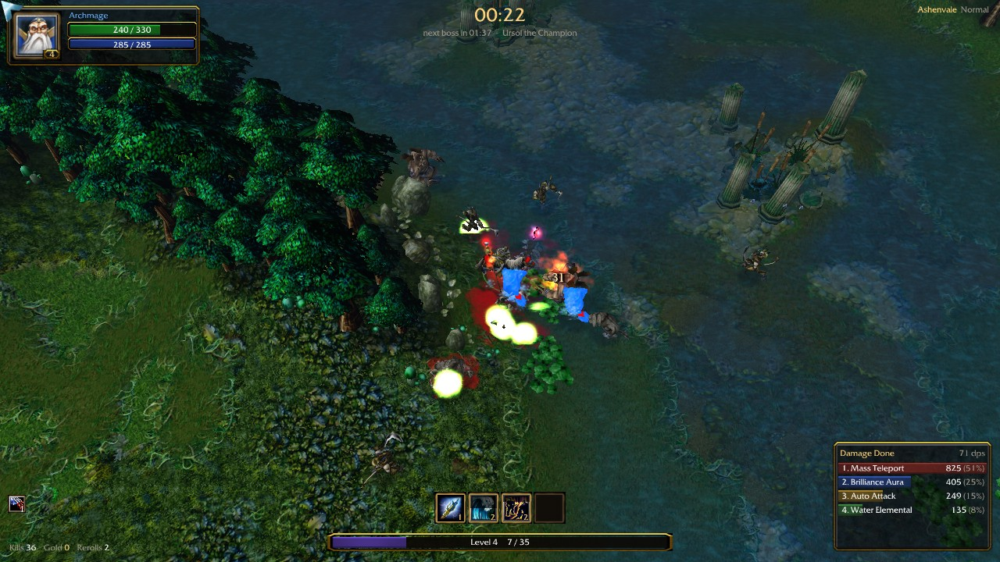
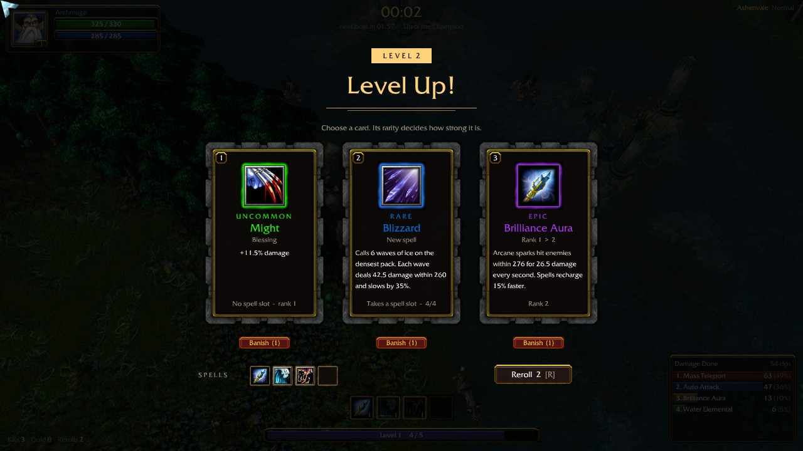
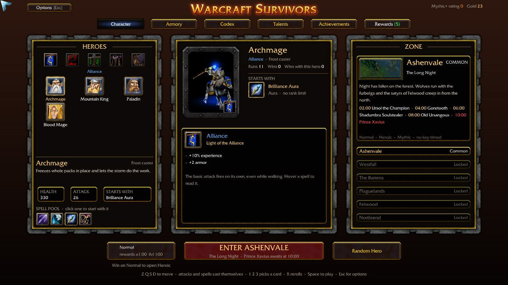
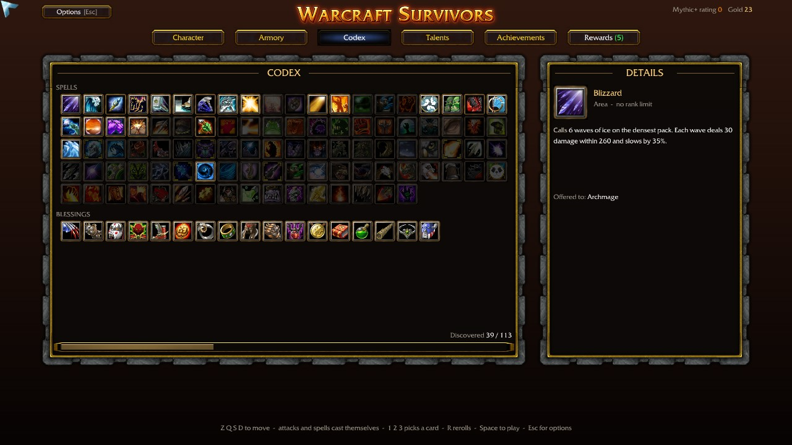
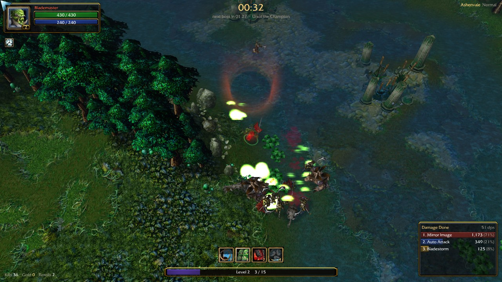

# Warcraft Survivors

A free, fan-made survivors game built from Warcraft III. Pick one of 24 heroes, walk into a
zone and survive ten minutes of ever-growing hordes. Your spells cast themselves; you move,
dodge, collect experience and choose a level-up card each level. Every two minutes a boss
arrives, and at 10:00 the zone's final boss.

It runs on [OpenRealm](https://github.com/corepunch/open-realm), an open-source C
reimplementation of the Warcraft III engine, with the art, models, sounds and music of your
own Warcraft III install. The same script also runs as a custom map in Warcraft III Reforged.



## Features

- **24 heroes** from the five factions of The Frozen Throne: Alliance, Horde, Undead, Night Elf
  and the Tavern. Each hero has its four Warcraft III abilities, reworked for a survivors game
  (Blizzard, Bladestorm, Feral Spirit, Starfall, Inferno...), and you choose which one it starts
  with. Each faction adds its own trait.
- **Level-up cards** in World of Warcraft rarities, from Common to Legendary: a new spell (four
  slots), a higher rank for one you have, or a blessing (damage, haste, area, spell duration...).
  **Nothing has a rank limit.** Reroll and banish cards you do not want.
- **Summons that pile up**: water elementals, spirit wolves, skeletons, treants, infernals and
  more each last one cooldown; raise your spell duration and the waves overlap into an army.
- **6 zones**: Ashenvale, Westfall, The Barrens, Plaguelands, Felwood and Northrend, each with
  its own enemies, four bosses and a final boss. Win a zone to open the next.
- **Difficulties**: Normal, Heroic, Mythic and Mythic+, with keystone levels that never end.
- **Between runs**: gear dropped by bosses (Armory), talents bought with gold, 25 achievements
  and their rewards, and a Codex of every spell and blessing.
- A damage meter, floating damage numbers, rebindable keys, mouse or keyboard movement, and
  separate volume for music, spells, units and ambience.



| Lobby | Codex |
| --- | --- |
|  |  |



## Controls

| Key | Action |
| --- | --- |
| Right-click | Walk there (default) |
| W A S D | Walk, when keyboard movement is on (Options > Keybinds) |
| 1 2 3 4 | Pick a level-up card |
| R | Reroll the cards |
| Space | Enter the zone (lobby) |
| Esc | Game menu: options, audio, keybinds, interface |

Every key can be rebound in the game menu.

## Playing

You need **Warcraft III 1.29 (Legacy) with The Frozen Throne**, installed from your own copy.
Reforged's data does not work with the standalone engine.

### Download (Windows)

1. Download `WarcraftSurvivors.exe` from the [Releases](../../releases) page (about 4 MB).
2. Run it. It unpacks the game and asks once where Warcraft III 1.29 is installed.
3. Play. Progress is saved in `%APPDATA%\warcraft-3\CustomMapData\WarcraftSurvivors\`.

### Build from source (Windows)

1. Install [MSYS2](https://www.msys2.org/). In the **UCRT64** shell, install the toolchain:
   ```sh
   pacman -S make diffutils mingw-w64-ucrt-x86_64-gcc mingw-w64-ucrt-x86_64-SDL2 \
             mingw-w64-ucrt-x86_64-zlib mingw-w64-ucrt-x86_64-libepoxy
   ```
2. Clone this repository, and the engine fork into `engine/`:
   ```sh
   git clone https://github.com/Willios/Warcraft-3-Mod-survivor
   cd Warcraft-3-Mod-survivor
   git clone -b survivor https://github.com/Willios/open-realm-williosfork engine
   ```
3. Build the engine from `engine/`:
   ```powershell
   powershell -ExecutionPolicy Bypass -File tools\build-windows.ps1 -Jobs 8
   ```
4. Copy `src\*.lua` and `src\art\*.tga` into `engine\dist\windows\share\warcraft-3\Scripts\Survivor\`.
5. Start `engine\dist\windows\play_survivor.bat` (it expects Warcraft III in
   `C:\Program Files (x86)\Warcraft III (Legacy)`; edit the path if yours is elsewhere).

`CLAUDE.md` has the detailed developer notes: every engine change, test aids, known issues.

### Warcraft III Reforged

Open `map/WarcraftSurvivor.w3m` in the World Editor, set Scenario > Map Options > Script
Language to Lua, and paste `src/ashenvale_survivor.lua` into the map's Custom Script Code.
The file must never contain a percent sign: the editor crashes on save.

## Repository layout

| Path | What it is |
| --- | --- |
| `src/ashenvale_survivor.lua` | The whole game: lobby, heroes, spells, zones, HUD, saves |
| `src/engine_boot.lua` | Entry point for the standalone engine (menu map, zone arenas) |
| `src/art/` | Lobby title art |
| `map/` | The Reforged map |
| `tools/smoketest/` | Runs the script against mocked natives: `python tools/smoketest/run.py` (needs `pip install lupa`) |
| `tools/engine_tests/` | Test scripts for the standalone engine |
| `tools/release/` | Builds the Windows download |
| `docs/screenshots/` | The pictures above |
| `engine/` | Not in this repository: the [OpenRealm fork](https://github.com/Willios/open-realm-williosfork/tree/survivor) is cloned here |

## How it works

Warcraft III maps are driven by scripts that call the game's natives (`CreateUnit`,
`AddSpecialEffect`, `BlzCreateFrame`...). Warcraft Survivors is one Lua script written against
those natives, so the same file runs in Reforged and in OpenRealm. Everything on screen, from
the lobby to the cards and the HUD, is built at runtime from the game's own textures, icons
and models: the script imports nothing.

The `survivor` branch of the engine adds what the script needs: a Lua 5.4 host that maps Lua
calls onto the engine's JASS natives, the Reforged UI-frame and keyboard natives, preload
files for saves, and fixes found along the way. The arenas are official melee maps
(Moonglade for now), with the creep camps removed.

## Credits

Warcraft Survivors stands on the work of many people. Thank you all.

- **[OpenRealm](https://github.com/corepunch/open-realm)** by corepunch and its contributors:
  the open-source Warcraft III engine this game runs on. Everything from loading the game's
  archives to drawing the world, the units and the interface is theirs; our fork only adds the
  Lua host and the natives the survivor script needs. Come say hi on the
  [OpenRealm Discord](https://discord.gg/MxkUMWsKGs).
- **[Warsmash Mod Engine](https://github.com/Retera/WarsmashModEngine)** by Retera, the
  open-source Warcraft III engine OpenRealm uses as a behavior reference.
- **[Azeroth Survivors](https://github.com/outthislife/azeroth-survivors-re)** by Aethus
  ([play it on the web](https://wow.aethus.pl)), the World of Warcraft survivors game that
  inspired this one and showed how a fan game can be built in the open.
- **[Vampire Survivors](https://store.steampowered.com/app/1794680/Vampire_Survivors/)** by
  poncle, which created the genre.
- **[Warcraft III](https://warcraft3.blizzard.com/)** by Blizzard Entertainment: the heroes,
  the world, the art, the sound and the music.

Libraries and tools:

- [Lua 5.4](https://www.lua.org/) (PUC-Rio), the scripting language, built into the engine
- [SDL2](https://www.libsdl.org/), [zlib](https://zlib.net/), [libepoxy](https://github.com/anholt/libepoxy),
  [minimp3](https://github.com/lieff/minimp3) and [blast](https://github.com/madler/zlib/tree/develop/contrib/blast)
  (Mark Adler), used by OpenRealm
- [MSYS2](https://www.msys2.org/), the Windows build environment
- [7-Zip](https://www.7-zip.org/) by Igor Pavlov, whose self-extractor packs the Windows download
- [lupa](https://github.com/scoder/lupa), which runs the smoke test's Lua from Python

## Game data and legal

This repository contains **no Blizzard game files**: no MPQ archives, models, textures,
sounds, music or maps. The game reads them at runtime from your own Warcraft III install.
The screenshots show Blizzard's art, rendered from such an install.

Warcraft Survivors is a non-commercial fan project. It is not affiliated with or endorsed by
Blizzard Entertainment. Warcraft and Warcraft III are trademarks or registered trademarks of
Blizzard Entertainment, Inc.

The code in this repository is under the MIT License (see `LICENSE`). OpenRealm is MIT-licensed
by its authors; the 7-Zip self-extractor in `tools/release/` keeps its own license
(`tools/release/7zSD-NOTICE.txt`).
